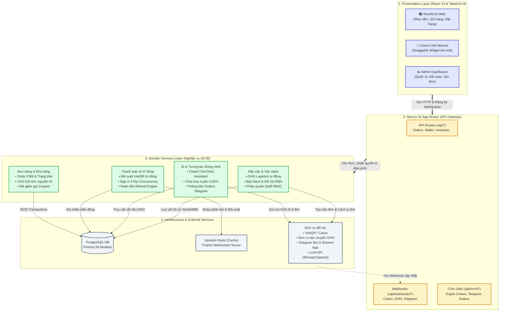
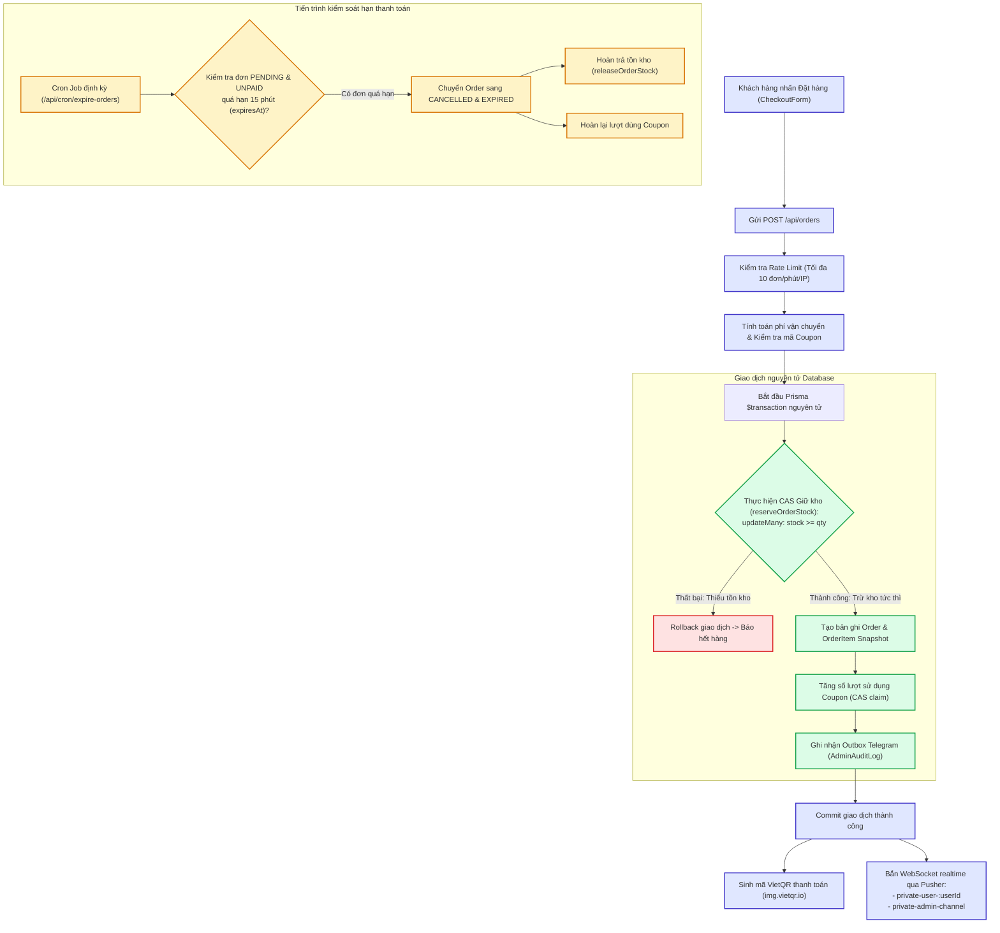
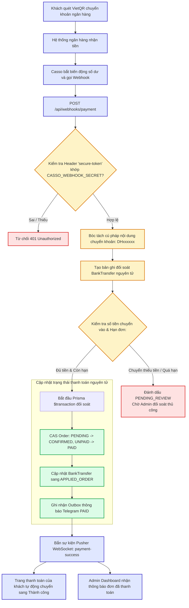
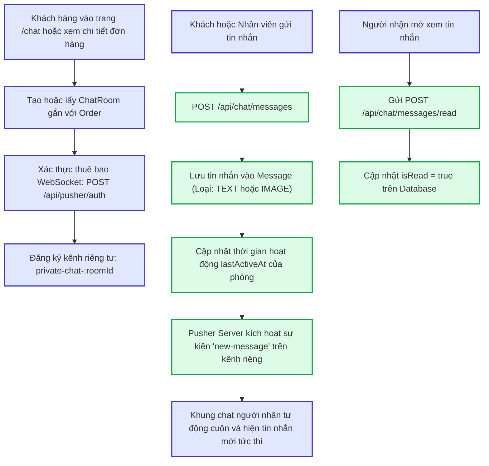
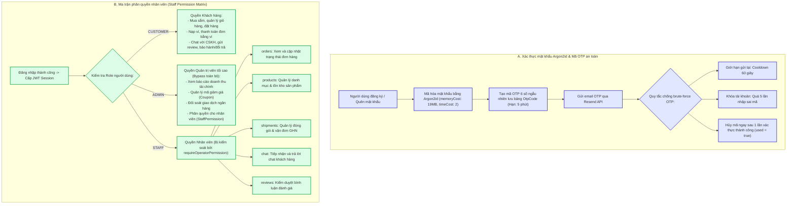

# Toàn bộ Pipeline Kiến trúc & Luồng Hoạt động Hệ thống (Shop QR Payment)

Tài liệu này tổng hợp đầy đủ 10 pipeline kiến trúc và tính năng nghiệp vụ của đồ án, được định dạng chuẩn cú pháp **Mermaid** để mở và render trực tiếp trong **Obsidian**, GitHub hoặc trình đọc Markdown.

---

## 1. Pipeline Kiến trúc Tổng thể Hệ thống (Clean Architecture 4 Tầng)



---

## 2. Pipeline: Luồng Tạo đơn hàng & Giữ kho nguyên tử (Order Creation & Atomic Stock Reservation)



---

## 3. Pipeline: Luồng Thanh toán VietQR & Đối soát Webhook (VietQR & Casso Reconciliation)



---

## 4. Pipeline: Luồng Ví nội bộ & Nạp tiền 4 lớp bảo vệ (Wallet Top-up & Payment)

```mermaid
flowchart TD
    subgraph TOPUP_FLOW ["A. Luồng Nạp tiền vào Ví"]
        T1["Khách chọn số tiền nạp (100k, 200k, 500k, 1M)"] --> T2["Tạo phiên nạp tiền (Mã NAPxxxxxx) lưu Redis 24h"]
        T2 --> T3["Hiển thị mã VietQR nạp tiền tĩnh"]
        T3 --> T4["Khách chuyển khoản ngân hàng với cú pháp NAPxxxxxx"]
        T4 --> T5["Casso gọi Webhook nạp tiền"]

        T5 --> T6["4 LỚP BẢO VỆ CONCURRENCY NGUYÊN TỬ:"]
        T6 --> L1["Lớp 1: Kiểm tra trạng thái phiên Redis (PENDING)"]
        L1 --> L2["Lớp 2: Khóa phân tán Redis Lock setNx 15 giây"]
        L2 --> L3["Lớp 3: Kiểm tra tính duy nhất mã giao dịch ngân hàng"]
        L3 --> L4["Lớp 4: Cộng số dư ví bằng CAS nguyên tử (increment)"]

        L4 --> T7["Ghi nhận WalletTransaction (Loại: TOPUP)"]
        T7 --> T8["Bắn sự kiện Pusher 'wallet-updated' -> Ví tăng số dư ngay"]
    end

    subgraph WALLET_PAY_FLOW ["B. Luồng Thanh toán đơn hàng bằng Ví"]
        P1["Khách chọn thanh toán bằng Ví Shop"] --> P2["Gửi POST /api/wallet/pay"]
        P2 --> P3["Kiểm tra đăng nhập & Quyền sở hữu đơn hàng"]
        P3 --> P4{"Kiểm tra số dư ví:<br/>wallet.balance >= order.totalAmount?"}
        P4 -- Không đủ --> P4_FAIL["Báo lỗi số dư không đủ"]

        P4 -- Đủ số dư --> P5["Bắt đầu Transaction trừ tiền nguyên tử"]

        subgraph TX_WALLET ["Giao dịch trừ tiền CAS"]
            P5 --> P6["CAS Order: UNPAID -> PAID, PENDING -> CONFIRMED"]
            P6 --> P7["CAS Wallet: Trừ số dư an toàn (balance: decrement)"]
            P7 --> P8["Ghi nhật ký biến động ví (PURCHASE_PAYMENT)"]
            P8 --> P9["Lưu Outbox Telegram thông báo đơn ví đã thanh toán"]
        end

        P9 --> P10["Cập nhật số dư realtime & Báo đơn thành công"]
    end

    classDef topup fill:#e0e7ff,stroke:#4338ca,stroke-width:2px;
    classDef pay fill:#dcfce7,stroke:#16a34a,stroke-width:2px;
    classDef err fill:#fee2e2,stroke:#dc2626,stroke-width:2px;

    class T1,T2,T3,T4,T5,T6,L1,L2,L3,L4,T7,T8 topup;
    class P1,P2,P3,P4,P5,P6,P7,P8,P9,P10 pay;
    class P4_FAIL err;
```



---

## 5. Pipeline: Luồng Vận chuyển & Giao hàng tự động GHN (Logistics Automation)

```mermaid
flowchart TD
    subgraph GEO ["A. Xác định địa chỉ khách hàng"]
        G1["Trình duyệt lấy tọa độ GPS (W3C Geolocation)"] --> G2["POST /api/shipping/geocode/reverse"]
        G2 --> G3{"Fallback phân cấp 3 tầng:"}
        G3 --> G_L1["Tầng 1: OpenStreetMap Nominatim"]
        G3 --> G_L2["Tầng 2: BigDataCloud Reverse API"]
        G3 --> G_L3["Tầng 3: Định vị IP mạng (ip-api.com)"]
        G_L1 & G_L2 & G_L3 --> G4["Fuzzy-match với tập dữ liệu hành chính GHN"]
        G4 --> G5["Điền tự động Quận/Huyện, Phường/Xã chuẩn GHN"]
    end

    subgraph SHIP_CREATE ["B. Tạo vận đơn GHN tự động"]
        S1["Đơn hàng chuyển sang PROCESSING"] --> S2["Gọi API GHN tạo đơn: createGHNShipment"]
        S2 --> S3["Tạo bản ghi Shipment (Mã vận đơn, Tiền COD, Trạng thái READY_TO_PICK)"]
    end

    subgraph WEBHOOK_SYNC ["C. Đồng bộ trạng thái giao hàng (GHN Webhook)"]
        W1["Shipper GHN cập nhật trạng thái gói hàng"] --> W2["GHN gọi POST /api/webhooks/ghn"]
        W2 --> W3{"Kiểm tra token bảo mật GHN_WEBHOOK_TOKEN"}
        W3 -- Sai --> W_FAIL["Từ chối 401"]

        W3 -- Đúng --> W4{"Chuyển đổi trạng thái đơn hàng (FSM):"}
        W4 -->|delivering| ST_1["Cập nhật Order: SHIPPING"]
        W4 -->|delivered| ST_2["Cập nhật Order: COMPLETED<br/>(Nếu là COD -> Tự động đánh dấu PAID)"]
        W4 -->|cancel / return| ST_3["Cập nhật Order: CANCELLED<br/>Hoàn trả tồn kho vào khu cách ly (Quarantine)"]

        ST_1 & ST_2 & ST_3 --> W5["Gửi thông báo in-app & WebSocket tới khách hàng"]
    end

    classDef geo fill:#fef3c7,stroke:#d97706,stroke-width:2px;
    classDef ship fill:#e0e7ff,stroke:#4338ca,stroke-width:2px;
    classDef hook fill:#dcfce7,stroke:#16a34a,stroke-width:2px;

    class G1,G2,G3,G_L1,G_L2,G_L3,G4,G5 geo;
    class S1,S2,S3 ship;
    class W1,W2,W3,W4,ST_1,ST_2,ST_3,W5 hook;
```



---

## 6. Pipeline: Luồng Thông báo bền vững Telegram Outbox (Durable Delivery Worker)

```mermaid
flowchart TD
    subgraph ENQUEUE ["1. Lưu hàng đợi thông báo bền vững (Transactional Outbox)"]
        E1["Sự kiện kinh doanh (Tạo đơn mới / Xác nhận thanh toán)"] --> E2["Bắt đầu Transaction"]
        E2 --> E3["Lưu bản ghi Outbox vào AdminAuditLog:<br/>action = TELEGRAM_OUTBOX<br/>operationKey = telegram:event:orderId<br/>status = PENDING, nextAttemptAt = now"]
        E3 --> E4["Commit cùng giao dịch nghiệp vụ"]
        E4 -->|Kích hoạt tức thì (Non-blocking)| E5["Next.js after() gọi nhanh Worker pass"]
    end

    subgraph WORKER ["2. Tiến trình xử lý hàng đợi (Cron Worker 1 phút)"]
        W1["GET /api/cron/process-telegram-outbox"] --> W2["Xác thực khóa bảo mật CRON_SECRET"]
        W2 --> W3["Quét danh sách Outbox PENDING hoặc RETRY đến hạn"]
        W3 --> W4{"Khóa bản ghi bằng Lease Token:<br/>CAS updateMany (lease = 2 phút)"}
        W4 -- Thất bại: Đã có worker khác giữ --> W_SKIP["Bỏ qua bản ghi này"]
        W4 -- Thành công --> W5["Gửi tin nhắn qua Telegram Bot API"]

        W5 --> W6{"Kết quả gửi Telegram:"}
        W6 -- Thành công (200 OK) --> W_OK["Cập nhật status = SENT, lưu messageId"]

        W6 -- Thất bại (Mất mạng / 429 / 5xx) --> W_ERR{"Thời gian tạo < 24 giờ?"}
        W_ERR -- Còn hạn 24h --> W_RETRY["Cập nhật status = RETRY<br/>Tính toán Exponential Backoff (1m, 2m, 5m, 10m...)"]
        W_ERR -- Hết hạn 24h --> W_FAIL["Đánh dấu status = FAILED<br/>Tạo cảnh báo SYSTEM_ALERT tới Admin qua Pusher & DB"]
    end

    subgraph TELEGRAM_APPROVE ["3. Duyệt đơn & Tạo vận đơn 1 chạm trên Telegram"]
        T1["Admin xem tin nhắn thanh toán trên Telegram"] --> T2["Admin bấm nút: 🚚 Duyệt & Tạo vận đơn GHN"]
        T2 --> T3["Telegram Bot gửi Webhook tới /api/webhooks/telegram"]
        T3 --> T4["Kiểm tra chữ ký bảo mật & Phân quyền Admin Chat ID"]
        T4 --> T5["Thực thi duyệt đơn: approveAndFulfillOrder(orderId)"]
        T5 --> T6["Tạo vận đơn GHN tự động qua API"]
        T6 --> T7["Cập nhật lại nội dung tin nhắn Telegram:<br/>Ghi mã vận đơn GHN & Bỏ nút bấm duyệt"]
    end

    classDef enq fill:#e0e7ff,stroke:#4338ca,stroke-width:2px;
    classDef worker fill:#dcfce7,stroke:#16a34a,stroke-width:2px;
    classDef bot fill:#fef3c7,stroke:#d97706,stroke-width:2px;
    classDef fail fill:#fee2e2,stroke:#dc2626,stroke-width:2px;

    class E1,E2,E3,E4,E5 enq;
    class W1,W2,W3,W4,W5,W6,W_OK,W_RETRY worker;
    class T1,T2,T3,T4,T5,T6,T7 bot;
    class W_FAIL fail;
```

---

## 7. Pipeline: Luồng Chatbot AI Assistant RAG (Clawd Chef)

```mermaid
flowchart TD
    subgraph UI_PET_FLOW ["1. Giao diện & Linh vật nổi Clawd Chef"]
        P1["Mascot Clawd Chef (DraggablePetWidget)<br/>Kéo thả tự do mọi vị trí, nhớ vị trí LocalStorage"] --> P2["Khách click vào Clawd -> Mở AssistantPanel"]
        P2 --> P3["Khách gửi tin nhắn câu hỏi"]
        P3 -->|Đổi trạng thái: Chú cua đội mũ khuấy nồi súp 🍲| P1
    end

    subgraph API_GATEWAY ["2. Cổng tiếp nhận & Giới hạn"]
        P3 --> G1["POST /api/assistant/conversations/:id/messages"]
        G1 --> G2["Định danh phiên: NextAuth Session hoặc Mã băm ẩn danh SHA-256"]
        G2 --> G3["Kiểm tra Quota giới hạn tốc độ (Redis 30 req/IP/h)"]
    end

    subgraph RAG_ENGINE ["3. Cơ chế phân loại & Truy xuất dữ liệu (RAG Retrieval)"]
        G3 --> R1{"Phân loại câu hỏi (isGreetingQuery)?"}

        R1 -- Lời chào hỏi (hi, hello, xin chào) --> R2["Bỏ qua quét database<br/>Tạo prompt chào mừng ấm áp của Clawd Chef"]

        R1 -- Hỏi về sản phẩm / Cấu hình --> R3["Truy vấn cơ sở dữ liệu PostgreSQL (Prisma)"]
        R3 --> R4["Trích xuất ngữ cảnh RAG Context:<br/>- Tên sản phẩm, hãng, giá niêm yết VND, tồn kho<br/>- Thông số kỹ thuật chi tiết (RAM, CPU, pin...)<br/>- Phản hồi thực tế từ khách đã mua (Review & số sao)"]

        R4 --> R5["Xây dựng Prompt chỉ dẫn Clawd Chef:<br/>- Phong cách ấm áp, nhiệt tình, lịch sự<br/>- Tóm tắt đánh giá thực tế (nếu có review)<br/>- Đi sâu thông số kỹ thuật (nếu chưa có review)<br/>- Định dạng Markdown đẹp mắt<br/>- Gợi ý câu hỏi tiếp theo (followUpQuestion)"]
        R2 --> R5
    end

    subgraph LLM_INFERENCE ["4. Kết nối mô hình AI ngoại vi (CustomHttpAiProvider)"]
        R5 --> L1["Gửi HTTP POST tới cổng LLM: /api/v1/chat/completions<br/>(9Router / OpenAI / Gemini / Local Model)"]
        L1 --> L2{"Trạng thái phản hồi?"}
        L2 -- 200 OK Thành công --> L3["Bóc tách kết quả linh hoạt:<br/>Hỗ trợ cả JSON và Markdown tự nhiên"]
        L2 -- Timeout / Mất mạng --> L4["Chế độ dự phòng an toàn (buildDeterministicAnswer):<br/>Trả lời lịch sự, không đổ bảng dữ liệu thô"]
    end

    subgraph RESPONSE_FLOW ["5. Lưu trữ & Trả kết quả"]
        L3 & L4 --> D1["Lưu tin nhắn vào AssistantMessage"]
        D1 --> D2["Trả kết quả về AssistantPanel"]
        D2 --> D3["Hiển thị nội dung Markdown đẹp mắt + Nút gợi ý câu hỏi 💡"]
        D3 -->|Tắt hoạt họa Cooking -> Clawd vẫy chào vui vẻ| P1
    end

    classDef pet fill:#e0e7ff,stroke:#4338ca,stroke-width:2px;
    classDef gate fill:#fef3c7,stroke:#d97706,stroke-width:2px;
    classDef rag fill:#dcfce7,stroke:#16a34a,stroke-width:2px;
    classDef llm fill:#f3e8ff,stroke:#9333ea,stroke-width:2px;

    class P1,P2,P3,D1,D2,D3 pet;
    class G1,G2,G3 gate;
    class R1,R2,R3,R4,R5 rag;
    class L1,L2,L3,L4 llm;
```



---

## 8. Pipeline: Luồng Hỗ trợ trực tuyến thời gian thực (Pusher Chat 1:1)



---

## 9. Pipeline: Luồng Sau bán hàng: Bảo hành & Đổi trả (Warranty & RMA FSM)

```mermaid
flowchart TD
    subgraph WARRANTY_FLOW ["A. Luồng Xử lý Yêu cầu Bảo hành (Warranty FSM)"]
        W1["Khách hàng tạo yêu cầu bảo hành (/warranties)"] --> W2["Trạng thái: SUBMITTED (Đã nộp đơn)"]
        W2 --> W3["Shop nhận máy -> Trạng thái: RECEIVED"]
        W3 --> W4["Kỹ thuật viên kiểm tra -> Trạng thái: INSPECTING"]
        W4 --> W5{"Kết quả thẩm định kỹ thuật:"}
        W5 -->|Sửa chữa thành công| WR_1["Trạng thái: RESOLVED (REPAIRED)<br/>Gửi trả lại máy đã sửa cho khách"]
        W5 -->|Lỗi nặng được đổi mới| WR_2["Trạng thái: RESOLVED (REPLACED)<br/>Xuất SerializedUnit mới thay thế"]
        W5 -->|Không có linh kiện thay thế| WR_3["Trạng thái: RESOLVED (REFUND_RECOMMENDED)<br/>Tạo RefundCase hoàn tiền về Ví Shop"]
        W5 -->|Vi phạm chính sách (rơi vỡ/vào nước)| WR_4["Trạng thái: REJECTED (Từ chối bảo hành)"]
    end

    subgraph RETURN_FLOW ["B. Luồng Đổi trả hàng hóa (RMA Quarantine FSM)"]
        R1["Khách gửi yêu cầu trả hàng (/returns)"] --> R2["Trạng thái: REQUESTED"]
        R2 --> R3["Shop duyệt yêu cầu -> Trạng thái: APPROVED"]
        R3 --> R4["Shop nhận lại hàng từ bưu tá -> Trạng thái: ITEM_RECEIVED"]
        R4 --> R5["TỰ ĐỘNG CHUYỂN KHO CÁCH LY:<br/>Tồn kho chuyển vào quarantinedStock (chưa được bán lại)"]
        R5 --> R6["Kiểm định chất lượng -> Trạng thái: INSPECTED"]
        R6 --> R7{"Quyết định phân loại hàng (Disposition):"}
        R7 -->|Còn mới nguyên vẹn| D_1["RESTOCK: Nhập lại kho bán (chuyển về onHandStock)"]
        R7 -->|Lỗi do nhà sản xuất| D_2["RETURN_TO_SUPPLIER: Trả về hãng/Nhà cung cấp"]
        R7 -->|Hư hỏng không thể dùng| D_3["DISPOSED: Tiêu hủy / Bỏ"]
        R7 -->|Từ chối trả hàng| D_4["REJECTED: Gửi trả lại cho khách"]

        D_1 & D_2 & D_3 --> R8["Kích hoạt RefundCase hoàn tiền theo tỷ lệ về Ví Shop"]
    end

    classDef warr fill:#e0e7ff,stroke:#4338ca,stroke-width:2px;
    classDef ret fill:#fef3c7,stroke:#d97706,stroke-width:2px;
    classDef quar fill:#fee2e2,stroke:#dc2626,stroke-width:2px;

    class W1,W2,W3,W4,W5,WR_1,WR_2,WR_3,WR_4 warr;
    class R1,R2,R3,R4,R6,R7,D_1,D_2,D_3,D_4,R8 ret;
    class R5 quar;
```

---

## 10. Pipeline: Luồng Xác thực, OTP & Phân quyền nhân viên (Auth, OTP & Staff RBAC)


