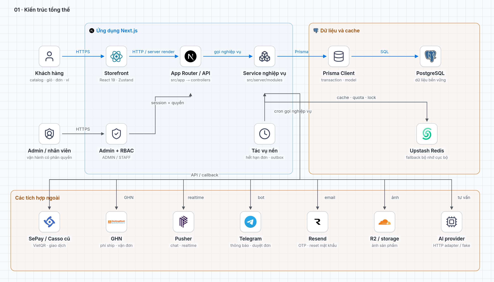
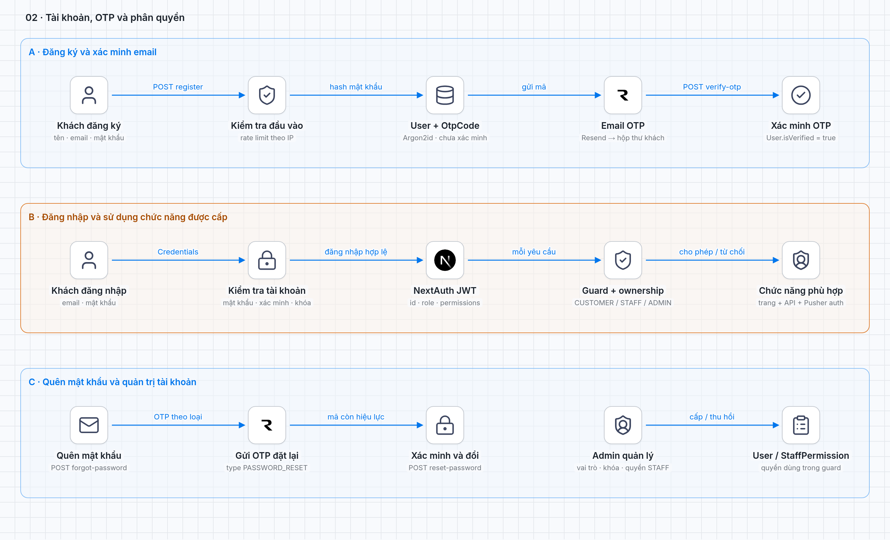
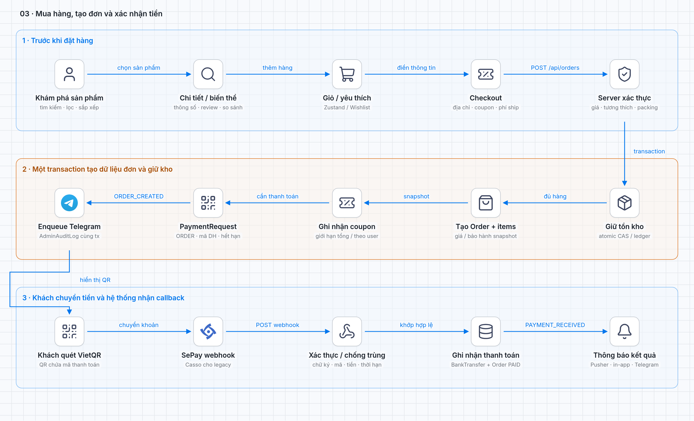
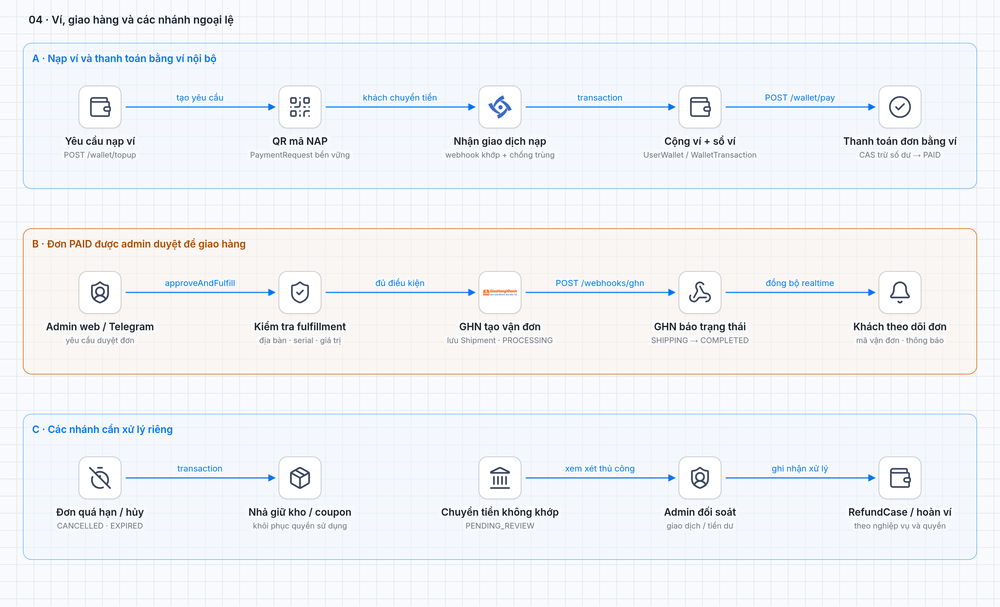
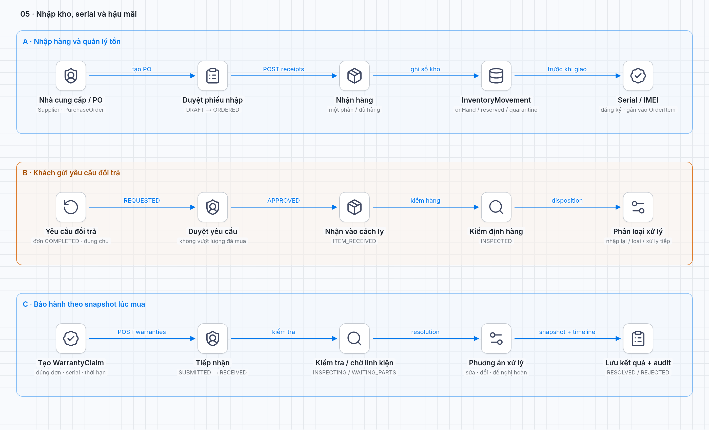
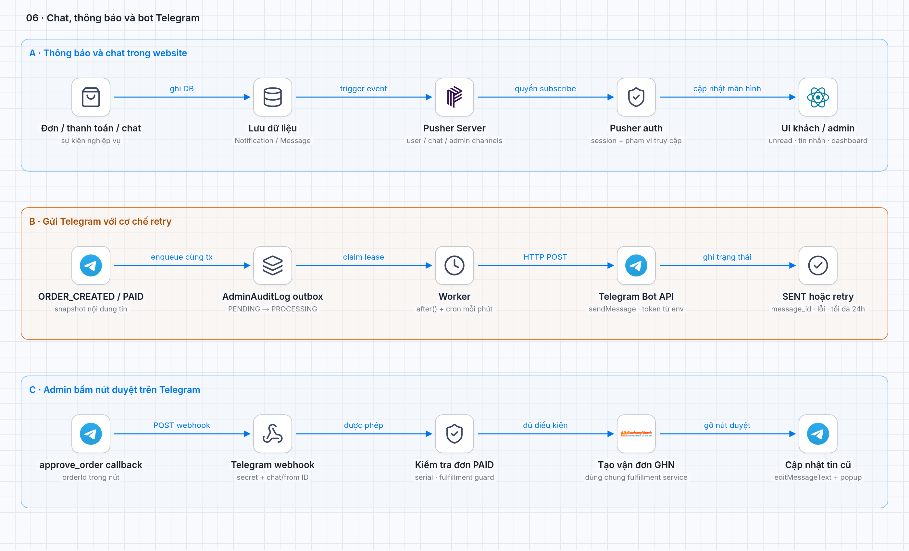
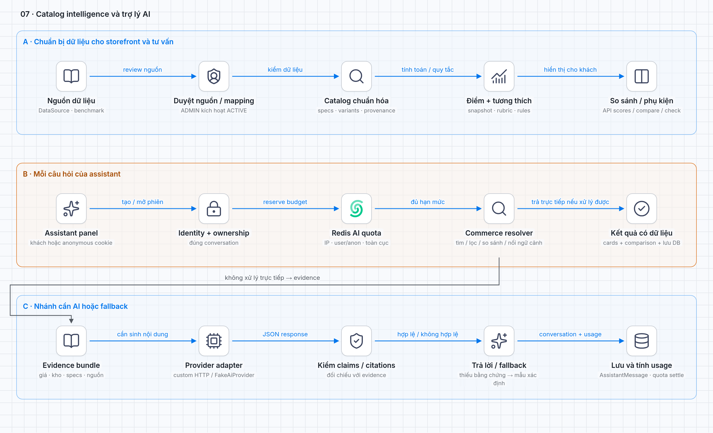

# Luồng hoạt động toàn bộ Shop QR Payment

Tài liệu đối chiếu mã nguồn ngày 16/11/2026. [Mở atlas có mục lục và nút sáng/tối](diagrams/project-flows.html). Các ảnh bên dưới được vẽ bằng stack-diagram; bản tối và HTML riêng có trong [danh mục sơ đồ](diagrams/README.md).

Ứng dụng gồm storefront, trang khách hàng, admin/STAFF, API nghiệp vụ và tác vụ nền. Các sơ đồ mô tả hành vi trong code; việc một tích hợp hoạt động thực tế còn tùy cấu hình triển khai.

## 01 · Kiến trúc tổng thể

Next.js chứa cả giao diện và API. Các service nghiệp vụ làm việc với Prisma/PostgreSQL, Redis và các dịch vụ ngoài. Đây là cấu trúc mã nguồn, không phải sơ đồ hạ tầng production đã được xác minh.

### Một ứng dụng, nhiều lớp

`src/app` khai báo trang và API. Server Component có thể đọc service để render; Client Component gọi HTTP API hoặc nhận sự kiện Pusher. `src/client` chứa view, component, hook và Zustand store. `src/server/modules` xử lý nghiệp vụ; `src/shared` chứa DTO, validation, constants và hàm dùng chung.

Controller kiểm tra yêu cầu/quyền rồi gọi service. Service dùng Prisma để thao tác PostgreSQL, nhiều thao tác tiền/kho nằm trong transaction. Client không truy cập database trực tiếp.

### Dữ liệu và dịch vụ ngoài

PostgreSQL lưu tài khoản, catalog, đơn, payment request, sổ ngân hàng/ví/kho, hội thoại và hậu mãi. Redis hỗ trợ cache sản phẩm/analytics, rate limit, quota và lock; code có fallback bộ nhớ khi không dùng Upstash. Fallback này chỉ thuộc từng process.

SePay là luồng thanh toán hiện tại; Casso còn cho legacy. GHN xử lý giao hàng; Pusher phát realtime; Resend gửi OTP. Upload ưu tiên Cloudflare R2, có Cloudinary và nhánh lưu local tùy cấu hình. Telegram và AI là hai tích hợp riêng, dùng biến môi trường riêng.

Đối chiếu: [prisma.ts](../../src/server/database/prisma.ts) · [Redis](../../src/server/infrastructure/redis.ts) · [upload service](../../src/server/modules/upload/upload.service.ts) · [schema Prisma](../../prisma/schema.prisma)

## 02 · Tài khoản, OTP và phân quyền

Đăng ký tạo User chưa xác minh. OTP gửi qua Resend. Đăng nhập dùng Credentials và JWT của NextAuth; API và trang admin kiểm tra vai trò/quyền theo từng chức năng.

### Đăng ký, đăng nhập, quên mật khẩu

- Đăng ký chuẩn hóa email, kiểm tra dữ liệu/rate limit, hash mật khẩu và tạo/cập nhật User chưa xác minh.

- OTP được quản lý qua OtpCode và gửi bằng Resend. Xác minh đúng loại OTP thì kích hoạt tài khoản; có hạn dùng, cooldown và giới hạn số lần thử.

- NextAuth Credentials kiểm tra thông tin đăng nhập và trạng thái tài khoản rồi tạo JWT session. Session mang id, role và danh sách quyền STAFF.

- Quên mật khẩu gửi OTP loại PASSWORD_RESET; reset-password kiểm tra mã rồi thay password hash. Đăng xuất do NextAuth xử lý.

### Ai làm được việc gì?

Khách có thể xem catalog và đặt đơn guest; các chức năng ví, wishlist đồng bộ, chat, đánh giá, hậu mãi và dữ liệu cá nhân yêu cầu session/quyền sở hữu phù hợp. Assistant còn hỗ trợ danh tính ẩn danh bằng cookie.

STAFF cần quyền cụ thể: orders, products, shipments, chat, reviews, inventory, warranties, knowledge, scoring hoặc assistant. ADMIN có toàn quyền trong guard. Các API tài chính, đổi vai trò, đối soát và xuất bản một số dữ liệu dùng kiểm tra ADMIN riêng. Có endpoint backend chưa có trang quản trị riêng; không nên suy từ việc có API rằng đã có đầy đủ UI.

Đối chiếu: [NextAuth](../../src/server/modules/auth/auth-options.ts) · [đăng ký](../../src/server/modules/auth/register.controller.ts) · [OTP/reset](../../src/server/modules/auth/password-reset.service.ts) · [guards](../../src/server/modules/admin/guards.ts) · [quyền STAFF](../../src/shared/constants/permissions.ts)

## 03 · Mua hàng, tạo đơn và xác nhận tiền

Giá, tồn kho, tương thích, coupon và phí giao đều được server xác thực lại. Luồng minh họa đơn cần trả tiền; đơn có tổng bằng 0 được tạo ở trạng thái PAID/CONFIRMED.

### Từ catalog đến đơn hàng

Khách tìm/lọc/sắp xếp sản phẩm, chọn biến thể, xem thông số/ảnh, so sánh và gợi ý phụ kiện tương thích. Giỏ hàng nằm ở Zustand có persistence. Wishlist có API lưu theo user. Coupon có luồng xem, lưu, kiểm tra điều kiện và áp dụng tại checkout.

Checkout lấy địa chỉ thủ công hoặc định vị: tọa độ → reverse geocode → ghép với danh sách địa bàn GHN; code có provider Nominatim/BigDataCloud và IP fallback. Server tính lại packing, phí ship, giá và coupon. Phụ kiện INCOMPATIBLE bị chặn; UNKNOWN cần xác nhận lưu ý.

Trong transaction: giữ tồn bằng ledger/CAS, lưu Order + OrderItem snapshot, ghi nhận lượt coupon, tạo PaymentRequest nếu cần trả tiền và enqueue ORDER_CREATED. Commit xong mới xử lý realtime/Telegram fast path.

### Khi tiền về

QR mang mã DH của đơn. Webhook SePay được xác thực bằng secret/HMAC; Casso dùng luồng legacy. Hệ thống chống xử lý trùng bằng mã giao dịch/fingerprint và cập nhật trạng thái có điều kiện.

Giao dịch hợp lệ được ghi vào BankTransfer. Nhánh tự động chỉ áp dụng khi mã, amount, payment request, thời điểm và trạng thái đơn phù hợp; transaction hoàn tất yêu cầu thanh toán, cập nhật Order thành PAID/CONFIRMED và enqueue PAYMENT_RECEIVED. Giao dịch không đủ điều kiện giữ ở PENDING_REVIEW để đối soát.

Giá/tên/SKU/biến thể/bảo hành/packing lúc mua được chụp vào OrderItem; thay catalog sau đó không thay dữ liệu đơn đã mua. Order status và paymentStatus là hai trường riêng.

Đối chiếu: [tạo đơn](../../src/server/modules/orders/orders.controller.ts) · [xác thực checkout](../../src/server/modules/compatibility/compatibility-cart.service.ts) · [phí giao/packing](../../src/server/modules/shipping/shipping-quote.service.ts) · [SePay webhook](../../src/server/modules/payment/sepay-webhook.controller.ts) · [áp dụng thanh toán](../../src/server/modules/payment/bank-order-payment.service.ts)

## 04 · Ví, giao hàng và các nhánh ngoại lệ

Ba luồng song song: nạp/chi ví, fulfillment GHN và xử lý ngoại lệ. Mỗi hàng được đọc từ trái sang phải; các hàng không phải là các bước nối tiếp bắt buộc.

### Nạp ví, chi ví, hoàn tiền

Nạp ví tạo PaymentRequest loại WALLET_TOPUP, mã NAP, QR và hạn thanh toán. Webhook khớp sẽ claim request/giao dịch, cộng UserWallet và tạo WalletTransaction trong transaction. PaymentRequest là dữ liệu bền vững; code còn hỗ trợ cache/session tương thích, không chỉ lưu phiên nạp trong Redis.

Thanh toán ví yêu cầu user sở hữu đơn còn hợp lệ. CAS trừ số dư khi đủ tiền, đánh dấu PAID, ghi sổ ví/ngân hàng và enqueue Telegram cùng transaction. UI nhận payment-success/wallet-updated.

Hoàn toàn bộ đơn có service refundOrderToWallet. Hoàn một phần có helper tính entitlement và phân bổ discount/giới hạn tổng đã hoàn. RefundCase dùng để theo dõi xử lý. API bank-review RESOLVE_REFUND ghi nhận đã xử lý theo tham chiếu admin, không tự gọi ngân hàng để chuyển tiền ra ngoài. Helper hoàn một phần chưa có route gọi trực tiếp trong cấu trúc API hiện tại.

### Fulfillment và ngoại lệ

Admin duyệt trên web hoặc Telegram đều gọi approveAndFulfillOrder. Service kiểm PAID, chưa hủy, địa bàn GHN, serial/IMEI và claim trạng thái chống tạo vận đơn lặp. Đơn trên 5.000.000đ được chuyển REVIEW theo quy tắc hiện tại của project, không phải khẳng định chính sách GHN ngoài hệ thống.

Tạo vận đơn thành công lưu Shipment và PROCESSING. GHN webhook đồng bộ SHIPPING/COMPLETED, sổ kho, log và thông báo; hủy/hoàn hàng có xử lý kho/hoàn tiền tương ứng. Đơn REVIEW do ADMIN xử lý: hủy và hoàn, hoặc ghi vận chuyển ngoài kèm mã vận đơn và tham chiếu đồng ý của khách.

Đơn chưa trả tiền có hạn 15 phút. Lazy check/cron dọn quá hạn, nhả kho và coupon. **vercel.json hiện lập lịch expire-orders mỗi ngày lúc 00:00 UTC**, nên job này không chạy mỗi 15 phút; hạn nghiệp vụ và lịch quét là hai việc khác nhau. Cron outbox chạy mỗi phút. Endpoint purge-conversations có trong code nhưng chưa được lên lịch trong vercel.json.

Đối chiếu: [nạp ví](../../src/server/modules/wallet/wallet-topup.service.ts) · [chi/hoàn ví](../../src/server/modules/wallet/wallet.service.ts) · [hoàn từng phần](../../src/server/modules/wallet/refund-case.service.ts) · [fulfillment](../../src/server/modules/orders/order-fulfillment.service.ts) · [xử lý REVIEW](../../src/server/modules/admin/fulfillment-review.controller.ts) · [bank review](../../src/server/modules/admin/bank-review.controller.ts) · [lịch cron](../../vercel.json)

## 05 · Nhập kho, serial và hậu mãi

Nhập hàng, đổi trả và bảo hành dùng state machine, operationKey và audit để kiểm soát thao tác. Hoàn tiền là luồng riêng; đóng yêu cầu không tự động đồng nghĩa tiền đã được hoàn.

### Kho và mua hàng từ nhà cung cấp

Supplier → PurchaseOrder/Item → nhận hàng một phần hoặc đủ. Trạng thái PO: DRAFT → ORDERED → PARTIALLY_RECEIVED → RECEIVED, có các nhánh hủy hợp lệ. Mỗi lần nhận hàng ghi InventoryMovement và cập nhật projection tồn kho.

`available = onHand − reserved − quarantined`. Đặt đơn tăng reserved; giao hàng tiêu thụ onHand và reserved; hàng trả về được cách ly rồi mới phân loại. operationKey/fingerprint chống ghi sổ lặp; stockVersion/CAS phát hiện xung đột. Có API điều chỉnh tồn và đối soát sổ kho.

SerializedUnit theo dõi từng serial/IMEI, nhận từ nhập hàng hoặc đăng ký, rồi gán đúng OrderItem. Thiết bị cần quản lý serial phải gán đủ trước khi fulfillment. Các chức năng supplier/PO/stock/serial hiện có API; không có các route page admin độc lập tương ứng trong src/app/admin.

### Đổi trả, bảo hành, đánh giá

Đổi trả: REQUESTED → APPROVED → ITEM_RECEIVED → INSPECTED → RESOLVED. Hệ thống xác nhận chủ đơn COMPLETED, số lượng còn được trả và serial; nhận hàng đưa vào quarantine. RESTOCKABLE trả về khả dụng; DISPOSED/RETURN_TO_SUPPLIER ghi giảm tồn; REFURBISH/DEFECTIVE để xử lý phù hợp tiếp.

Bảo hành kiểm snapshot và thời hạn tính từ completedAt. SUBMITTED → RECEIVED → INSPECTING, có WAITING_PARTS, rồi RESOLVED/REJECTED hoặc nhánh hủy phù hợp. Kết quả gồm sửa, đổi máy hoặc REFUND_RECOMMENDED; đề nghị hoàn tạo RefundCase riêng.

Review yêu cầu người mua có đơn COMPLETED chứa sản phẩm; chống review trùng theo product/user/order. Admin/STAFF có quyền reviews có thể kiểm duyệt và phản hồi. Review được dùng cho trang sản phẩm và tổng hợp tín hiệu intelligence.

Đối chiếu: [procurement](../../src/server/modules/procurement/procurement.service.ts) · [ledger kho](../../src/server/modules/inventory/inventory-ledger.service.ts) · [serial](../../src/server/modules/inventory/serialized-unit.service.ts) · [đổi trả](../../src/server/modules/returns/return.service.ts) · [bảo hành](../../src/server/modules/warranties/warranty.service.ts) · [review](../../src/server/modules/reviews/review.service.ts)

## 06 · Chat, thông báo và bot Telegram

Chat CSKH lưu Message rồi phát realtime. Telegram thông báo đơn dùng hàng đợi bền vững; bot đọc TELEGRAM_BOT_TOKEN và TELEGRAM_CHAT_ID từ môi trường, không dùng token LLM.

### Chat và thông báo trong website

Đơn gắn với phòng CSKH cho khách đã đăng nhập theo luồng tạo đơn. ChatRoom/Message lưu lịch sử; API kiểm session và quyền truy cập phòng trước khi đọc/gửi/đánh dấu đã đọc. Pusher phát new-message, trạng thái gõ và cập nhật liên quan.

Notification lưu inbox, isRead và unread count. Pusher phát theo `private-user-{id}`, `private-chat-{roomId}` và `private-admin-channel`; /api/pusher/auth kiểm tra quyền đăng ký kênh. Trang admin dùng analytics-updated để tải lại dữ liệu dashboard.

Dashboard tổng hợp số đơn, thanh toán, doanh thu, sản phẩm và khách; staff analytics có phạm vi riêng. Admin còn có màn quản lý sản phẩm, đơn, coupon, khách hàng, vận đơn, giao dịch, review, đổi trả, bảo hành, chat và audit logs.

### Bot Telegram thật sự gửi thế nào?

Tạo đơn hoặc thanh toán enqueue vào AdminAuditLog với action TELEGRAM_OUTBOX, payload chỉ chứa text/chatId/replyMarkup. Worker lấy bản ghi đến hạn, claim lease, đọc token từ env và POST Telegram sendMessage. Thành công lưu message_id; lỗi retry theo lịch 1/2/5/10/30/60 phút, tôn trọng retry_after, thời gian sống 24h. Thất bại cuối tạo SYSTEM_ALERT cho các User có role ADMIN trên web.

Token lấy từ TELEGRAM_BOT_TOKEN. Nơi nhận mặc định TELEGRAM_CHAT_ID. Các tin nhắn là template xác định, **không dùng LLM và không tiêu token model AI**. after() hỗ trợ gửi sớm; cron mỗi phút xử lý hàng đợi/retry.

Nút duyệt gửi approve_order:orderId vào webhook. Code kiểm secret nếu được cấu hình và so configured chat ID với from/chat ID; sau đó gọi fulfillment, trả popup và sửa tin cũ. Nếu chat ID là nhóm, kiểm tra hiện tại cho phép callback trong nhóm đã cấu hình, không ánh xạ từng người bấm về User ADMIN trong database.

Đối chiếu: [chat](../../src/server/modules/chat/chat-messages.controller.ts) · [Pusher auth](../../src/server/modules/chat/pusher-auth.controller.ts) · [Notification](../../src/server/modules/notifications/notifications.service.ts) · [outbox](../../src/server/modules/telegram/telegram-outbox.service.ts) · [Telegram API](../../src/server/infrastructure/telegram.ts) · [callback](../../src/server/modules/telegram/telegram-webhook.controller.ts)

## 07 · Catalog intelligence và trợ lý AI

Điểm sản phẩm và tương thích là nghiệp vụ dựa trên dữ liệu/rule. AI chỉ được gọi ở nhánh cần sinh câu trả lời; nhiều câu tìm kiếm/so sánh được xử lý trực tiếp bằng commerce service.

### Catalog intelligence không phải tất cả đều là AI

Catalog chuẩn hóa Brand/Category/Product/Variant, thông số có nguồn, readiness và dữ liệu benchmark. DataSource qua bước review license/mapping; ADMIN mới kích hoạt ACTIVE. Scoring rubric theo category và các snapshot dùng benchmark/spec/review/sales signals để tính điểm theo use-case/giá trị; recompute/xuất bản là hành động có quyền riêng.

Comparison ghép giá, thông số, score, review và bằng chứng. CompatibilityRule xử lý cặp thiết bị–phụ kiện theo quy tắc để trả COMPATIBLE / INCOMPATIBLE / UNKNOWN; có API tạo/kích hoạt/thu hồi rule. Khi checkout server kiểm lại, không tin assertion do client tự gửi.

Quản lý nguồn, rubric và rule hiện có API; không có page admin riêng cho từng nhóm này trong cây route hiện tại. Upload ảnh admin kiểm định dạng/dung lượng/magic bytes rồi gọi storage; URL lưu vào catalog.

### AI assistant: chỉ gọi model khi cần

- Xác định user/anonymous cookie, kiểm ownership conversation, lưu câu hỏi và reserve quota Redis.

- Commerce resolver dùng dữ liệu catalog để tìm hàng, lọc giá, xử lý so sánh và tham chiếu lượt trước. Nhánh xử lý được trả card/so sánh trực tiếp, usage model bằng 0.

- Nhánh còn lại dựng evidence bundle. Tổng quan catalog/không có sản phẩm phù hợp có thể trả lời xác định mà không gọi model.

- Nếu cần sinh nội dung, adapter gửi evidence tới custom HTTP provider. Chỉ nhận claims/citations phù hợp; thiếu bằng chứng, lỗi, timeout hoặc từ chối sẽ dùng deterministic fallback.

- Settle quota/usage và lưu AssistantMessage. Hội thoại có expiresAt; có endpoint xóa và purge hết hạn.

Provider hiện được chọn theo AI_API_BASE_URL hoặc AI_API_KEY → CustomHttpAiProvider; nếu cả hai không có → FakeAiProvider. AI_PROVIDER trong .env.example không phải cờ được resolveDefaultAiProvider đọc. Model/token/endpoint AI độc lập Telegram.

Đối chiếu: [nguồn dữ liệu](../../src/server/modules/catalog/data-source.service.ts) · [scoring](../../src/server/modules/intelligence/scoring.service.ts) · [compatibility](../../src/server/modules/compatibility/compatibility.service.ts) · [chọn provider](../../src/server/modules/assistant/assistant.controller.ts) · [assistant orchestration](../../src/server/modules/assistant/assistant.service.ts) · [quota](../../src/server/infrastructure/ai/quota.ts)

## Danh mục chức năng

Các nhóm dưới đây liên kết với những luồng đã mô tả; danh sách route đầy đủ ở phần sau.

| Nhóm chức năng | Luồng / dữ liệu chính | Trang hoặc API |
| --- | --- | --- |
| Tài khoản / phân quyền | User, OtpCode, StaffPermission → session → guard | /login, /register, /verify-otp, /forgot-password · /api/auth/* · /api/admin/customers |
| Catalog / sản phẩm / upload | Brand/Category/Product/Variant, specs, ảnh và nguồn dữ liệu | /, /products/[id], /admin/products · /api/products · /api/admin/upload |
| So sánh / scoring / tương thích | BenchmarkMeasurement, ProductScoreSnapshot, CompatibilityRule | /api/products/compare · /api/scores/* · /api/compatibility/* · /api/admin/scoring-rubrics |
| Giỏ / wishlist / coupon | Giỏ local, Wishlist, Coupon và savedCouponIds | /cart, /wishlist, /coupons · /api/wishlist · /api/coupons/* · /api/admin/coupons |
| Checkout / order / money | Order + snapshot → giữ kho → PaymentRequest; BigInt tiền được serialize | /checkout, /orders, /payment/[orderId] · /api/orders/* · /api/payments/[code] |
| Thanh toán / đối soát | SePay/Casso → BankTransfer → PAID hoặc PENDING_REVIEW; reconciliation báo cáo | /admin/transactions · /api/webhooks/sepay, /api/webhooks/payment · /api/admin/bank-review · /api/admin/transactions/* |
| Ví / hoàn tiền | UserWallet, WalletTransaction, PaymentRequest NAP, RefundCase | /wallet · /api/wallet/* · /api/admin/fulfillment-review, /api/admin/bank-review |
| Giao hàng / định vị | Địa bàn + packing → phí GHN → Shipment → webhook cập nhật | /admin/shipments · /api/shipping/* · /api/webhooks/ghn · /api/admin/shipments |
| Kho / nhập hàng / serial | Supplier → PurchaseOrder → InventoryMovement → SerializedUnit | /api/admin/suppliers · /api/admin/purchase-orders/* · /api/admin/inventory/* |
| Đổi trả / bảo hành / review | ReturnRequest, WarrantyClaim, Review → ownership/FSM/audit | /returns, /warranties · /api/returns/* · /api/warranties/* · /api/products/[id]/reviews · admin pages tương ứng |
| Chat / thông báo | ChatRoom/Message/Notification → Pusher private channel → UI | /chat/*, /notifications, /admin/chat/* · /api/chat/* · /api/notifications/* · /api/pusher/auth |
| Telegram | Outbox trong AdminAuditLog → retry worker → Bot API → callback | /api/cron/process-telegram-outbox · /api/webhooks/telegram |
| Assistant | Conversation + Message → quota → commerce/evidence → provider/fallback | Assistant panel · /api/assistant/conversations/* · /api/cron/purge-conversations |
| Admin / analytics / audit | RBAC → dữ liệu vận hành / thống kê tài chính / lịch sử thao tác | /admin/* · /api/admin/analytics, /staff · /api/admin/audit-logs |
| Tác vụ nền / scripts | Hết hạn đơn, outbox, purge; seed/demo, import địa bàn, backup/restore, evaluation AI | vercel.json · /api/cron/* · package.json scripts |

## Các trang giao diện

Đường dẫn bỏ route group `(auth)` vì group này không xuất hiện trên URL. Các trang có kiểm session/role/ownership theo từng luồng ở trên.

| URL | File trang |
| --- | --- |
| `/forgot-password` | [src/app/(auth)/forgot-password/page.tsx](<../../src/app/(auth)/forgot-password/page.tsx>) |
| `/login` | [src/app/(auth)/login/page.tsx](<../../src/app/(auth)/login/page.tsx>) |
| `/register` | [src/app/(auth)/register/page.tsx](<../../src/app/(auth)/register/page.tsx>) |
| `/verify-otp` | [src/app/(auth)/verify-otp/page.tsx](<../../src/app/(auth)/verify-otp/page.tsx>) |
| `/admin/audit-logs` | [src/app/admin/audit-logs/page.tsx](<../../src/app/admin/audit-logs/page.tsx>) |
| `/admin/chat/[roomId]` | [src/app/admin/chat/[roomId]/page.tsx](<../../src/app/admin/chat/[roomId]/page.tsx>) |
| `/admin/chat` | [src/app/admin/chat/page.tsx](<../../src/app/admin/chat/page.tsx>) |
| `/admin/coupons` | [src/app/admin/coupons/page.tsx](<../../src/app/admin/coupons/page.tsx>) |
| `/admin/customers` | [src/app/admin/customers/page.tsx](<../../src/app/admin/customers/page.tsx>) |
| `/admin/orders` | [src/app/admin/orders/page.tsx](<../../src/app/admin/orders/page.tsx>) |
| `/admin` | [src/app/admin/page.tsx](<../../src/app/admin/page.tsx>) |
| `/admin/products` | [src/app/admin/products/page.tsx](<../../src/app/admin/products/page.tsx>) |
| `/admin/returns` | [src/app/admin/returns/page.tsx](<../../src/app/admin/returns/page.tsx>) |
| `/admin/reviews` | [src/app/admin/reviews/page.tsx](<../../src/app/admin/reviews/page.tsx>) |
| `/admin/shipments` | [src/app/admin/shipments/page.tsx](<../../src/app/admin/shipments/page.tsx>) |
| `/admin/transactions` | [src/app/admin/transactions/page.tsx](<../../src/app/admin/transactions/page.tsx>) |
| `/admin/warranties` | [src/app/admin/warranties/page.tsx](<../../src/app/admin/warranties/page.tsx>) |
| `/cart` | [src/app/cart/page.tsx](<../../src/app/cart/page.tsx>) |
| `/chat/[roomId]` | [src/app/chat/[roomId]/page.tsx](<../../src/app/chat/[roomId]/page.tsx>) |
| `/chat` | [src/app/chat/page.tsx](<../../src/app/chat/page.tsx>) |
| `/checkout` | [src/app/checkout/page.tsx](<../../src/app/checkout/page.tsx>) |
| `/coupons` | [src/app/coupons/page.tsx](<../../src/app/coupons/page.tsx>) |
| `/notifications` | [src/app/notifications/page.tsx](<../../src/app/notifications/page.tsx>) |
| `/orders` | [src/app/orders/page.tsx](<../../src/app/orders/page.tsx>) |
| `/` | [src/app/page.tsx](<../../src/app/page.tsx>) |
| `/payment/[orderId]` | [src/app/payment/[orderId]/page.tsx](<../../src/app/payment/[orderId]/page.tsx>) |
| `/products/[id]` | [src/app/products/[id]/page.tsx](<../../src/app/products/[id]/page.tsx>) |
| `/returns` | [src/app/returns/page.tsx](<../../src/app/returns/page.tsx>) |
| `/wallet` | [src/app/wallet/page.tsx](<../../src/app/wallet/page.tsx>) |
| `/warranties` | [src/app/warranties/page.tsx](<../../src/app/warranties/page.tsx>) |
| `/wishlist` | [src/app/wishlist/page.tsx](<../../src/app/wishlist/page.tsx>) |

## API: phương thức và controller

Bảng được lấy từ các file route thực tế. Đây là điểm vào HTTP; logic nghiệp vụ và kiểm quyền nằm ở controller/service được liên kết. Có API cho kho, nguồn tri thức và scoring chưa có trang admin riêng.

| Endpoint | Method | Controller / route |
| --- | --- | --- |
| `/api/admin/analytics` | GET | [analytics.controller](../../src/server/modules/admin/analytics.controller.ts) |
| `/api/admin/analytics/staff` | GET | [route.ts](../../src/app/api/admin/analytics/staff/route.ts) |
| `/api/admin/audit-logs` | GET | [audit-log.controller](../../src/server/modules/admin/audit-log.controller.ts) |
| `/api/admin/bank-review` | GET, POST | [route.ts](../../src/app/api/admin/bank-review/route.ts) |
| `/api/admin/compatibility/rules/[id]/activate` | POST | [compatibility.controller](../../src/server/modules/compatibility/compatibility.controller.ts) |
| `/api/admin/compatibility/rules/[id]/revoke` | POST | [compatibility.controller](../../src/server/modules/compatibility/compatibility.controller.ts) |
| `/api/admin/compatibility/rules` | GET, POST | [compatibility.controller](../../src/server/modules/compatibility/compatibility.controller.ts) |
| `/api/admin/coupons` | DELETE, GET, PATCH, POST | [coupons.controller](../../src/server/modules/admin/coupons.controller.ts) |
| `/api/admin/customers` | GET, PATCH | [customers.controller](../../src/server/modules/admin/customers.controller.ts) |
| `/api/admin/data-sources` | GET, POST | [route.ts](../../src/app/api/admin/data-sources/route.ts) |
| `/api/admin/fulfillment-review` | POST | [route.ts](../../src/app/api/admin/fulfillment-review/route.ts) |
| `/api/admin/inventory/adjustments` | POST | [stock-adjustment.controller](../../src/server/modules/inventory/stock-adjustment.controller.ts) |
| `/api/admin/inventory/serialized-units/assign` | POST | [serialized-unit.controller](../../src/server/modules/inventory/serialized-unit.controller.ts) |
| `/api/admin/inventory/serialized-units` | GET, POST | [serialized-unit.controller](../../src/server/modules/inventory/serialized-unit.controller.ts) |
| `/api/admin/purchase-orders/[id]/receipts` | POST | [procurement.controller](../../src/server/modules/procurement/procurement.controller.ts) |
| `/api/admin/purchase-orders/[id]` | GET, PATCH | [procurement.controller](../../src/server/modules/procurement/procurement.controller.ts) |
| `/api/admin/purchase-orders` | GET, POST | [procurement.controller](../../src/server/modules/procurement/procurement.controller.ts) |
| `/api/admin/reviews` | DELETE, GET, PATCH | [admin-reviews.controller](../../src/server/modules/reviews/admin-reviews.controller.ts) |
| `/api/admin/scoring-rubrics` | GET, PUT | [route.ts](../../src/app/api/admin/scoring-rubrics/route.ts) |
| `/api/admin/shipments` | GET | [shipments.controller](../../src/server/modules/admin/shipments.controller.ts) |
| `/api/admin/suppliers` | GET, POST | [procurement.controller](../../src/server/modules/procurement/procurement.controller.ts) |
| `/api/admin/transactions/reconcile` | POST | [reconcile.controller](../../src/server/modules/admin/reconcile.controller.ts) |
| `/api/admin/transactions` | GET | [transactions.controller](../../src/server/modules/admin/transactions.controller.ts) |
| `/api/admin/upload` | POST | [route.ts](../../src/app/api/admin/upload/route.ts) |
| `/api/assistant/conversations/[id]/messages` | GET, POST | [route.ts](../../src/app/api/assistant/conversations/[id]/messages/route.ts) |
| `/api/assistant/conversations/[id]` | DELETE | [route.ts](../../src/app/api/assistant/conversations/[id]/route.ts) |
| `/api/assistant/conversations` | GET, POST | [route.ts](../../src/app/api/assistant/conversations/route.ts) |
| `/api/auth/[...nextauth]` | GET, POST | [auth-options](../../src/server/modules/auth/auth-options.ts) |
| `/api/auth/forgot-password` | POST | [forgot-password.controller](../../src/server/modules/auth/forgot-password.controller.ts) |
| `/api/auth/register` | POST | [register.controller](../../src/server/modules/auth/register.controller.ts) |
| `/api/auth/resend-otp` | POST | [resend-otp.controller](../../src/server/modules/auth/resend-otp.controller.ts) |
| `/api/auth/reset-password` | POST | [reset-password.controller](../../src/server/modules/auth/reset-password.controller.ts) |
| `/api/auth/verify-otp` | POST | [verify-otp.controller](../../src/server/modules/auth/verify-otp.controller.ts) |
| `/api/chat/messages/read` | POST | [chat-read.controller](../../src/server/modules/chat/chat-read.controller.ts) |
| `/api/chat/messages` | GET, POST | [chat-messages.controller](../../src/server/modules/chat/chat-messages.controller.ts) |
| `/api/chat/rooms` | GET | [chat-rooms.controller](../../src/server/modules/chat/chat-rooms.controller.ts) |
| `/api/compatibility/accessories` | GET | [compatibility.controller](../../src/server/modules/compatibility/compatibility.controller.ts) |
| `/api/compatibility/check` | GET | [compatibility.controller](../../src/server/modules/compatibility/compatibility.controller.ts) |
| `/api/coupons` | GET | [route.ts](../../src/app/api/coupons/route.ts) |
| `/api/coupons/saved` | DELETE, GET, POST | [route.ts](../../src/app/api/coupons/saved/route.ts) |
| `/api/coupons/validate` | POST | [route.ts](../../src/app/api/coupons/validate/route.ts) |
| `/api/cron/expire-orders` | GET, POST | [expire-orders.controller](../../src/server/modules/orders/expire-orders.controller.ts) |
| `/api/cron/process-telegram-outbox` | GET, POST | [telegram-outbox.controller](../../src/server/modules/telegram/telegram-outbox.controller.ts) |
| `/api/cron/purge-conversations` | POST | [route.ts](../../src/app/api/cron/purge-conversations/route.ts) |
| `/api/notifications/count` | GET | [notifications-count.controller](../../src/server/modules/notifications/notifications-count.controller.ts) |
| `/api/notifications` | GET, PATCH | [notifications.controller](../../src/server/modules/notifications/notifications.controller.ts) |
| `/api/orders/[id]` | GET, PATCH | [order-detail.controller](../../src/server/modules/orders/order-detail.controller.ts) |
| `/api/orders` | POST | [orders.controller](../../src/server/modules/orders/orders.controller.ts) |
| `/api/payments/[code]` | GET | [payment-status.controller](../../src/server/modules/payment/payment-status.controller.ts) |
| `/api/products/[id]/reviews` | GET, POST | [product-reviews.controller](../../src/server/modules/reviews/product-reviews.controller.ts) |
| `/api/products/compare` | GET, POST | [route.ts](../../src/app/api/products/compare/route.ts) |
| `/api/products` | DELETE, GET, POST, PUT | [products.controller](../../src/server/modules/products/products.controller.ts) |
| `/api/pusher/auth` | POST | [pusher-auth.controller](../../src/server/modules/chat/pusher-auth.controller.ts) |
| `/api/returns/[id]/disposition` | POST | [route.ts](../../src/app/api/returns/[id]/disposition/route.ts) |
| `/api/returns/[id]` | GET | [route.ts](../../src/app/api/returns/[id]/route.ts) |
| `/api/returns/[id]/transition` | POST | [route.ts](../../src/app/api/returns/[id]/transition/route.ts) |
| `/api/returns` | GET, POST | [route.ts](../../src/app/api/returns/route.ts) |
| `/api/scores/recompute` | POST | [route.ts](../../src/app/api/scores/recompute/route.ts) |
| `/api/scores` | GET | [route.ts](../../src/app/api/scores/route.ts) |
| `/api/shipping/fee` | POST | [shipping-fee.controller](../../src/server/modules/shipping/shipping-fee.controller.ts) |
| `/api/shipping/geocode/reverse` | POST | [route.ts](../../src/app/api/shipping/geocode/reverse/route.ts) |
| `/api/wallet/pay` | POST | [wallet-pay.controller](../../src/server/modules/wallet/wallet-pay.controller.ts) |
| `/api/wallet` | GET | [wallet.controller](../../src/server/modules/wallet/wallet.controller.ts) |
| `/api/wallet/topup` | POST | [wallet-topup.controller](../../src/server/modules/wallet/wallet-topup.controller.ts) |
| `/api/wallet/topup/simulate` | POST | [route.ts](../../src/app/api/wallet/topup/simulate/route.ts) |
| `/api/warranties/[id]` | GET | [route.ts](../../src/app/api/warranties/[id]/route.ts) |
| `/api/warranties/[id]/transition` | POST | [route.ts](../../src/app/api/warranties/[id]/transition/route.ts) |
| `/api/warranties` | GET, POST | [route.ts](../../src/app/api/warranties/route.ts) |
| `/api/webhooks/ghn` | POST | [ghn-webhook.controller](../../src/server/modules/shipping/ghn-webhook.controller.ts) |
| `/api/webhooks/payment` | POST | [casso-webhook.controller](../../src/server/modules/payment/casso-webhook.controller.ts) |
| `/api/webhooks/sepay` | POST | [sepay-webhook.controller](../../src/server/modules/payment/sepay-webhook.controller.ts) |
| `/api/webhooks/telegram` | POST | [telegram-webhook.controller](../../src/server/modules/telegram/telegram-webhook.controller.ts) |
| `/api/wishlist` | DELETE, GET, POST | [wishlist.controller](../../src/server/modules/wishlist/wishlist.controller.ts) |

## Tác vụ vận hành và công cụ

- `expire-orders`: giải phóng đơn quá hạn, tồn đã giữ và coupon; lịch hiện tại `0 0 * * *` trong vercel.json (07:00 giờ Việt Nam).

- `process-telegram-outbox`: chạy mỗi phút để gửi/retry thông báo Telegram.

- `purge-conversations`: có endpoint dọn hội thoại hết hạn, chưa có lịch trong vercel.json.

- `db:backup` / `db:restore`: sao lưu và phục hồi database; `db:backfill-inventory` cùng script reconcile hỗ trợ kiểm tra/migrate sổ kho và tiền.

- `ghn:import`: nhập danh mục địa bàn GHN. Seed và import catalog/demo tạo dữ liệu mẫu/chuẩn hóa sản phẩm.

- `eval:assistant`, `eval:commerce` và các biến thể online: đánh giá assistant/commerce intelligence. `docs:uml` sinh UML; `schema:budget` kiểm quy mô model.

- `test`, `test:integration`, `lint`, `arch:check`, `build`: kiểm thử, ràng buộc kiến trúc và build; `verify` chạy chuỗi kiểm tra này.

Đối chiếu: [package.json](../../package.json), [vercel.json](../../vercel.json), [scripts](../../scripts).

Phạm vi kiểm kê: **73 file API route**, **31 trang**, 7 sơ đồ.
