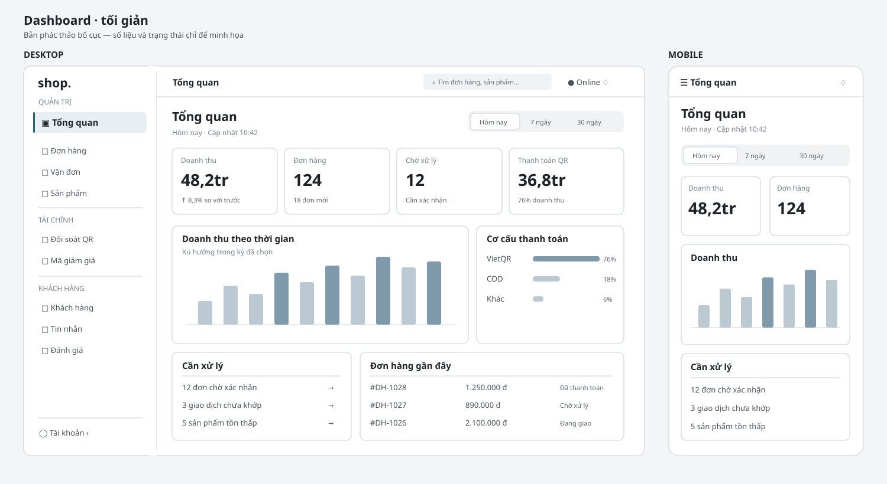
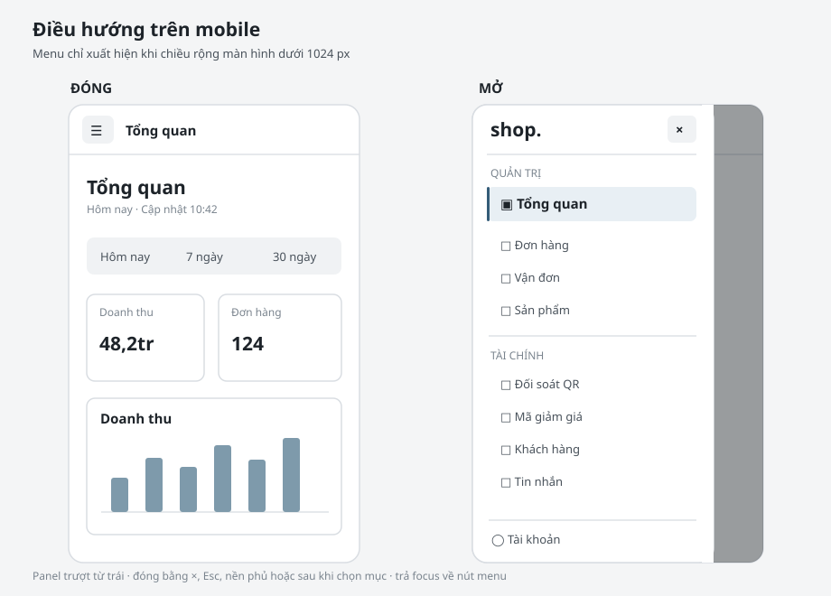

# Thiết kế áp dụng Animate UI cho khu vực quản trị

Trạng thái: đã duyệt và triển khai vào khu vực quản trị ngày 04/11/2026.

## Mục tiêu

- Dashboard tối giản, ưu tiên số liệu và việc cần xử lý.
- Sidebar luôn hiện ở desktop, chỉ dùng nút menu và panel trượt ở màn hình nhỏ.
- Animate UI hỗ trợ phản hồi thao tác; dữ liệu cập nhật liên tục không nhấp nháy hoặc chuyển động gây xao nhãng.
- Giữ nguyên số liệu, API, realtime và phân quyền ADMIN/STAFF hiện có.

## Bố cục

### Desktop, từ 1024 px

- Sidebar rộng khoảng 240 px, nền trắng, đường viền mảnh. Mục hiện tại có nền xám nhạt và vạch nhấn nhỏ. Nút thu gọn ở cuối/đầu sidebar; trạng thái thu gọn được ghi nhớ như hiện tại.
- Topbar ngắn: tên trang, tìm kiếm, trạng thái kết nối dưới dạng chữ, thông báo và tài khoản. Chỉ một nút hành động chính phù hợp với trang.
- Phần đầu dashboard: tiêu đề “Tổng quan”, ngày và bộ chọn Hôm nay / 7 ngày / 30 ngày. Không dùng lời chào, huy hiệu trang trí hay hiệu ứng ping.
- Hàng 1: bốn KPI gọn, số lớn, nhãn rõ và biến động nhỏ nếu có dữ liệu.
- Hàng 2: biểu đồ doanh thu rộng 2/3; cơ cấu thanh toán 1/3.
- Hàng 3: “Cần xử lý” và “Đơn hàng gần đây”. Những bảng phụ như sản phẩm, khách hàng, realtime đi xuống dưới để phần đầu trang ngắn và dễ quét.

### Mobile, dưới 1024 px

- Topbar có nút mở điều hướng. Sidebar hiện thành panel trượt từ trái, có lớp phủ và nút đóng.
- Panel mobile rộng tối đa 280 px và cuộn được nếu danh mục dài. Nó mở từ cạnh trái, không thay đổi vị trí nội dung trang. Mục hiện tại được đánh dấu như ở desktop.
- KPI xếp 2 cột ở tablet, 1 cột ở điện thoại nhỏ. Biểu đồ và danh sách xếp dọc.
- Bộ chọn thời gian giữ đủ nhãn, có vùng chạm tối thiểu 44 px. Các bảng có cuộn ngang hoặc chuyển thành danh sách khi thích hợp.

## Animate UI sẽ dùng ở đâu

| Vị trí | Thành phần/hiệu ứng | Quy tắc |
| --- | --- | --- |
| Chọn khoảng thời gian | `ToggleGroup` | Chỉ nền mục chọn dịch chuyển nhẹ; dữ liệu không bay vào khi refresh. |
| Sidebar desktop | `@animate-ui/react/primitives/sidebar` (`Provider`, `Container`, `Highlight`) | Giữ sidebar luôn hiện; chuyển trạng thái thu gọn đang lưu trong localStorage sang `open` có điều khiển. |
| Điều hướng mobile | `Dialog` dạng Sheet từ trái | Có quản lý focus, Esc, lớp phủ, trả focus về nút mở. |
| Bộ lọc và menu thao tác ở các trang quản trị | `DropdownMenu` | Mở/đóng ngắn, giữ điều hướng bàn phím. |
| Xác nhận thao tác có tác động | `Dialog`/`AlertDialog` theo mức độ | Nội dung và nút rõ ràng, không dùng hiệu ứng nổi bật quá mức. |
| Sidebar thu gọn và trạng thái active | `Sidebar` và lớp CSS hiện tại được chỉnh đồng bộ | Không làm nội dung nhảy khi đổi trang; trạng thái active luôn nhận ra được khi không hover. |

Ứng dụng hiện chưa có `@animate-ui/react`, `motion`, `radix-ui` hoặc `components.json`; vì vậy sẽ tích hợp primitive bằng tay, không chạy CLI dành cho shadcn/ui. Cài các package vào gói ứng dụng Next.js. Bản preview Baoyu có một bundle React riêng cho trang HTML; không đưa bundle đó vào app. Dùng `AnimateUIProvider` với `reducedMotion="user"`. Giữ `framer-motion` ở những thành phần hiện có cho đến khi chúng được rà riêng.

Các API này được đối chiếu với tài liệu chính thức: [gói và peer dependency](https://animate-ui.com/docs/react), [Sidebar headless](https://animate-ui.com/docs/primitives/radix-ui/sidebar), [Sheet xây trên Dialog](https://animate-ui.com/docs/primitives/radix-ui/sheet), [Toggle Group](https://animate-ui.com/docs/primitives/radix-ui/toggle-group).

## Điểm chạm trong mã hiện tại

| File | Thay đổi dự kiến |
| --- | --- |
| `src/client/components/admin/layout/AdminAppShell.tsx` | Đặt provider và giữ trạng thái thu gọn đã lưu; quản lý panel mobile. |
| `src/client/components/admin/layout/AdminSidebar.tsx` | Giữ điều kiện quyền và đường dẫn; dùng sidebar primitive cho chuyển động và highlight. |
| `src/client/components/admin/layout/AdminTopbar.tsx` | Rút gọn trình bày; nút mở menu chỉ hiện trên mobile. |
| `src/client/views/admin/AdminDashboardView.tsx` | Bố cục lại vùng dữ liệu; thay bộ chọn kỳ bằng Toggle Group. |
| `src/client/components/ui/ConfirmDialog.tsx` | Chuyển sang Dialog/Alert Dialog khi rà các thao tác quản trị liên quan. |

## Trạng thái dữ liệu và quyền

- Dashboard ADMIN dùng dữ liệu phân tích hiện tại: doanh thu, đơn hàng, thanh toán, cảnh báo và đơn mới.
- STAFF chỉ thấy KPI vận hành, cảnh báo và danh sách được quyền truy cập. Sidebar tiếp tục lọc theo permission.
- Giữ nguyên range `today` / `7days` / `month`, refresh, polling và Pusher; đổi giao diện không đổi ý nghĩa số liệu.
- Loading dùng skeleton tĩnh, lỗi có nút “Thử lại”, số liệu cập nhật trong vùng `aria-live` phù hợp nhưng tránh thông báo mỗi lần polling.

## Trình tự triển khai sau khi duyệt

1. Thêm Animate UI và provider vào app; tạo wrapper chung cho các primitive được dùng.
2. Làm lại sidebar/topbar và dashboard theo bản vẽ, giữ nguyên API và phân quyền.
3. Áp dụng dropdown, bộ lọc và dialog chung cho Orders, Products, Transactions và các trang admin còn lại khi phù hợp.
4. Kiểm tra desktop/mobile, bàn phím, reduced motion, ADMIN/STAFF và dữ liệu realtime trước khi mở rộng ra khu vực khách hàng.

## Tiêu chí chấp nhận

- Ở desktop, đi tới mọi mục quản trị mà không cần mở menu ba gạch.
- Ở mobile, panel điều hướng đóng bằng Esc, nút đóng, lớp phủ hoặc sau khi chọn mục; focus được quản lý đúng.
- Số liệu và quyền truy cập khớp với dashboard trước thay đổi.
- Chuyển động có chủ đích, ngắn và tắt/giảm theo thiết lập hệ điều hành.
- Không thêm màu trang trí để thể hiện cùng một ý nghĩa đã có bằng nhãn hoặc số.

## Ghi chú sau triển khai

- Sidebar desktop, panel mobile, bộ chọn thời gian, bộ lọc Orders/Transactions và hộp xác nhận dùng Animate UI. Dashboard dùng dữ liệu phân tích và luồng realtime hiện có.
- Đã xác minh bằng unit tests, integration tests, TypeScript, lint mã nguồn, kiểm tra kiến trúc và build production sạch với Webpack.
- Môi trường browser tự động không khả dụng trong phiên này, nên cần kiểm tra trực quan và thao tác với tài khoản ADMIN/STAFF trên máy có browser trước khi phát hành.
- Các trang Orders, Products và Shipments hiện có vẫn chuyển STAFF về trang chủ dù sidebar cũ đã hiện mục theo permission. Đây là giới hạn phân quyền có trước thay đổi giao diện; cần xử lý riêng cùng kiểm tra dữ liệu nhạy cảm trước khi mở quyền truy cập các trang đó.
