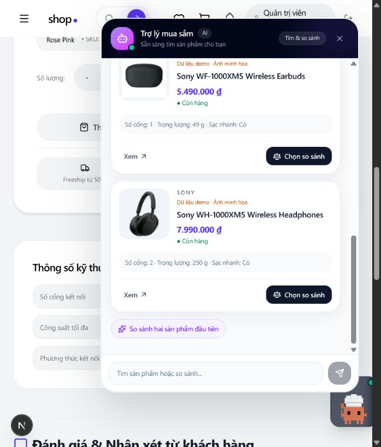

# Demo product photo verification

Kept all 50 existing technology products. Added 27 local WebP assets with source URLs and product/family mappings in `prisma/data/demo-product-images.json`. Some products share an illustrative photo of the same family. Galaxy Fold6 and Flip6 use separate Samsung product images.

The images-only refresh updates `image`, `images` and `catalogVersion`; it preserves custom photos, identifiers, prices, specifications, visibility and inventory. The first local update refreshed 50 products and saved `backups/demo-catalog-before-1794727414832.json`. A subsequent dry-run reported zero updates. The final refresh updated only the two folding-phone photos and saved `backups/demo-catalog-before-1794728770945.json`.

Validation:

- Full isolated unit suite: 1,125 passed, zero failed.
- Focused catalog, assistant and preparation suite: 23 passed.
- TypeScript and scoped ESLint passed.
- All 50 product mappings resolve to local, decodable photographic assets.
- Browser: catalog lists 50 products; Logitech Lift detail photo loads via Next Image, with original price and stock displayed. Searching “Tìm tai nghe Sony” returns four clickable product cards; all four thumbnails loaded successfully.
- The comparison banner previously removed at the user's request remains removed.

The first broad test run without isolation encountered sandbox process restrictions. Running without test isolation outside the sandbox exposed HTTP mock interference between unrelated shipping tests. The normal isolated test command outside the sandbox passed all tests.

